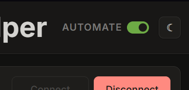

# VPN Helper

Forti mu suka down? Suka mengambil alih jendela yang sedang tampil? Suka tiba-tiba membuka jendela baru padahal lagi fokus kerja? Susah ditakedown?

Coba pake ini. Aku ga jamin anti down, tapi ini ga semaruk Forti dalam menggunakan resource dan jaringan PC mu. Also, dia ga akan ujug-ujug buka tab SSO ketika koneksi VPN naik-turun.

[Langsung ke Persiapan](#persiapan)

---
## Ini Apa?
VPN pengganti FortiClient dan GlobalProtect. Berjalan mandiri langsung di desktop dan system tray tanpa memakan resource berlebih.

---
## ANNOUNCEMENT: Migrasi ke C# .NET 9 & Deprekasi Python
Versi Python (Flask/Web UI) telah **dideprecate secara bertahap** dan kini sepenuhnya digantikan oleh arsitektur **C# .NET 9 Desktop Native**. 

Keuntungan versi baru ini:
- **True Standalone Executable**: Tidak butuh instalasi Python, pip, atau web browser.
- **Hemat Resource**: Konsumsi RAM sangat ringan (~30 MB).
- **Fluent Dark UI & Native Systray**: Antarmuka modern yang otomatis meminimalkan diri ke system tray saat tersambung.

> [!NOTE]
> Seiring migrasi BPS RI ke GlobalProtect, integrasi protokol baru ini sedang diuji hingga batas evaluasi 31 Desember 2026. Apabila aplikasi resmi GlobalProtect pada saat itu terbukti sudah mampu memenuhi standar _fast and reliable_ secara mandiri, maka fungsi VPN Helper telah usai dan proyek ini akan dipensiunkan karena tujuannya telah tercapai.

---

## Changelog

| Versi | Perubahan |
| --- | --- |
| `2.26.1119.pc` | **Major Release: Migrasi Total ke C# .NET 9 Native**.<br>• Deprekasi penuh versi Python/Flask.<br>• Biner tunggal mandiri (`VPN Helper.exe`) tanpa perlu instalasi Python atau browser web.<br>• Antarmuka desktop WPF Fluent Dark & System Tray terintegrasi.<br>• Dukungan dual-mode: FORTI (`akses.bps.go.id`) dan GP (`vpn.bps.go.id`).<br>• Penyederhanaan instalasi via `requirements.bat` (auto-download OpenConnect & auto-launch aplikasi). |
| `1.26.0924.pc` | Menambahkan fungsi eksperimental untuk VPN GlobalProtect. Fitur ini belum bisa dipakai maksimal mengingat transisi VPN yang masih berjalan di pusat. |
| `1.26.0914.lt2` | Implementasi bypass aplikasi. Aplikasi yang koneksinya terputus/timeout gara-gara dialihkan ke VPN Helper bisa dimasukkan ke daftar bypass ini. |
| `1.26.0914.lt` | Menambahkan uji coba akomodasi pengguna ber-OTP |
| `1.26.0905.lt` | Perbaikan automasi yang kadang gagal berjalan, perbaikan file enkripsi |
| `1.26.0903.pc` | Perbaikan automate yang gagal jalan secara otomatis |
| `1.26.0708.lt` | Systray fix |
| `1.26.0629.lt` | Memperbaiki kegagalan redirect ke link callback |
| `1.26.0627.lt` | Modul terpisah |
| `1.26.0522` | Menambahkan config versi aplikasi.<br>Menyiapkan updater otomatis dari GitHub. |

---
## Extras
VPN itu pada dasarnya bikin tunnel: jalur khusus dari komputer kita ke jaringan tujuan. Aplikasi ini ngurus login SSO dan sesi gateway-nya, tapi tetap butuh mesin tunnel yang beneran mengangkat traffic jaringan. Mesin itu namanya OpenConnect.

Silakan ikuti langkah menginstal OpenConnect di section [**Persiapan**](#persiapan).

Nyariin fitur ini ya?



Fitur itu udah terinstal di VPN Helper mu tanpa kamu sadari. Kalo mo diaktifkan, chat wa aku ya. Ohiya FYI, fitur ini useless kalo kamu pake OTP. Jadi kalo ber-OTP, cuma bisa mode biasa ya ges.

---
## DISCLAIMER
Aplikasi ini dirilis di 19 Mei 2026. sudah melalui berbagai stress test dari beberapa pengguna, sehingga versinya terus terus lebih baik dari sebelumnya hingga hari ini. dengan menggunakannya, anda juga secara tidak langsung berpartisipasi dalam uji stres. sangat dianjurkan untuk secara aktif melaporkan bug yang anda temui, biar VPN Helper semakin baik lagi.

---
## Persiapan

### Cara Termudah (Rekomendasi):
1. Kunjungi halaman **[Releases](https://github.com/tiomultazem/vpn-helper/releases)** pada repositori ini.
2. Unduh berkas ZIP rilis terbaru (`VPN-Helper.zip`), lalu ekstrak isinya ke folder mana pun di komputermu.
3. Di dalam folder hasil ekstrak, cukup jalankan **`requirements.bat`**:
   - Skrip ini akan otomatis mendeteksi apakah OpenConnect sudah terpasang. Jika belum, skrip akan mengunduh installer OpenConnect secara otomatis.
   - Setelah OpenConnect terinstal, skrip akan **langsung meluncurkan file `VPN Helper.exe` secara otomatis**.
4. Selesai! Untuk pemakaian sehari-hari selanjutnya, Anda cukup membuka **`VPN Helper.exe`**.

---

### Langkah Manual & Panduan OpenConnect:

1. **Unduh OpenConnect**:
   Jika `requirements.bat` tidak dapat mengunduh secara otomatis atau Anda ingin memasangnya manual, gunakan tautan resmi berikut:
   - [Direct OpenConnect 64-bit installer](https://www.infradead.org/openconnect-gui/download/openconnect-gui-1.6.2-win64.exe)

2. **PENTING: Opsi Console & System PATH**:
   Saat jendela instalasi OpenConnect tampil (baik lewat `requirements.bat` maupun manual):
   - Pada halaman *Install Options*, pilih opsi: **Add OpenConnect to the system PATH for all users**.
   - Pada halaman *Choose Components*, **wajib centang opsi console**.

   

   *Bila opsi PATH terlewat*, Anda dapat menambahkannya manual melalui PowerShell (Run as Administrator):
   ```powershell
   [Environment]::SetEnvironmentVariable("Path", [Environment]::GetEnvironmentVariable("Path", "Machine") + ";C:\Program Files\OpenConnect-GUI", "Machine")
   ```
   Atau via Command Prompt (Administrator):
   ```cmd
   setx PATH "%PATH%;C:\Program Files\OpenConnect-GUI" /M
   ```

3. **Verifikasi Instalasi**:
   Buka PowerShell dan jalankan perintah berikut untuk memastikan versi OpenConnect adalah `v9.x`:
   ```powershell
   & "C:\Program Files\OpenConnect-GUI\openconnect.exe" --version
   ```
   Pastikan yang keluar adalah versi `v9.12` atau varian 9.x lainnya (bukan di bawah 9.x).

4. **Konfigurasi Akun (`.env`)**:
   Saat pertama kali membuka `VPN Helper.exe`, jika berkas `.env` belum tersedia, aplikasi akan menampilkan dialog verifikasi pegawai BPS. Masukkan jawaban yang diminta (huruf kecil semua) agar berkas `.env` ter-generate otomatis.
   Buka berkas `.env` tersebut dan isi kredensial akun SSO Anda:
   ```env
   SSO_USERNAME="username sso mu, hapus petik"
   SSO_PASSWORD="password sso mu, hapus petik"
   ```
> [!NOTE]
> isi SSO di sini hanya untuk mode automate. Bila anda tidak mau automate, mau login manual aja di browser, ya sudah tidak perlu mengisi.

5. **Jalankan Aplikasi**:
   Cukup klik dua kali pada **`VPN Helper.exe`** (atau jalankan via `run.bat`).

---

## Cara Penggunaan

Ada 3 indikator status di kartu antarmuka aplikasi:
- **SSO**: Berubah hijau (*Terautentikasi*) ketika login SSO Keycloak berhasil.
- **Gateway**: Berubah hijau (*Terverifikasi*) ketika token gateway berhasil ditukar dan sesi SSL/TLS terkonfirmasi.
- **VPN**: Berubah hijau (*Terhubung*) ketika terowongan OpenConnect aktif mengalirkan traffic jaringan.

Tombol antarmuka:
- **Connect**: Menjalankan autentikasi SSO, verifikasi gateway, dan otomatis mengangkat tunnel VPN. Setelah terhubung dan seluruh kartu status berwarna hijau, aplikasi akan otomatis meminimalkan diri ke system tray setelah jeda visual 1,5 detik.
- **Disconnect**: Memutus tunnel VPN dan membersihkan sesi gateway.
- **Toggle Mode (FORTI / GP)**: Memilih protokol terowongan antara Fortinet (`akses.bps.go.id`) atau GlobalProtect (`vpn.bps.go.id`).

---

## QnA
Feel free to reach me out via WhatsApp.

---

## License

This project is distributed under the VPN Helper Use-Only License.

Use of this software is free of charge. Modification, publication of modified versions, sublicensing, selling, renting, or repackaging requires prior written permission from the copyright holder.

See [LICENSE](LICENSE) for the full English and Indonesian license text.
